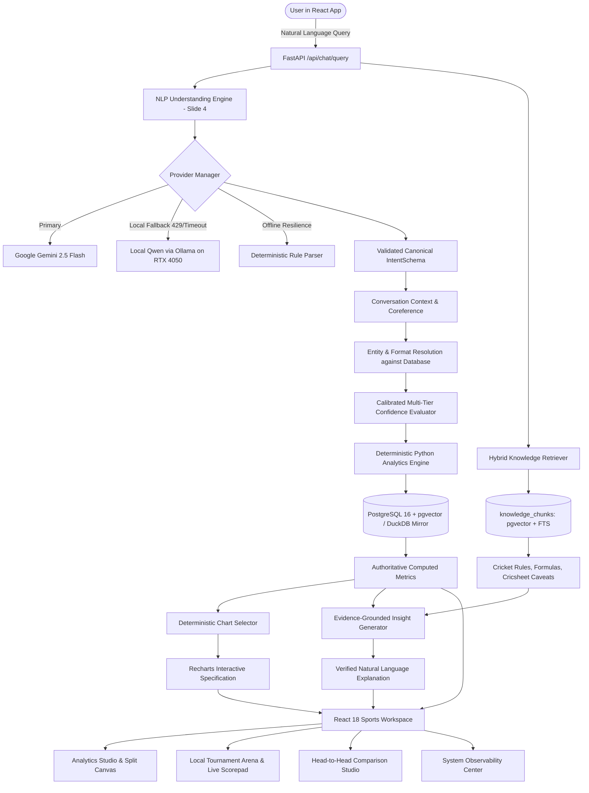
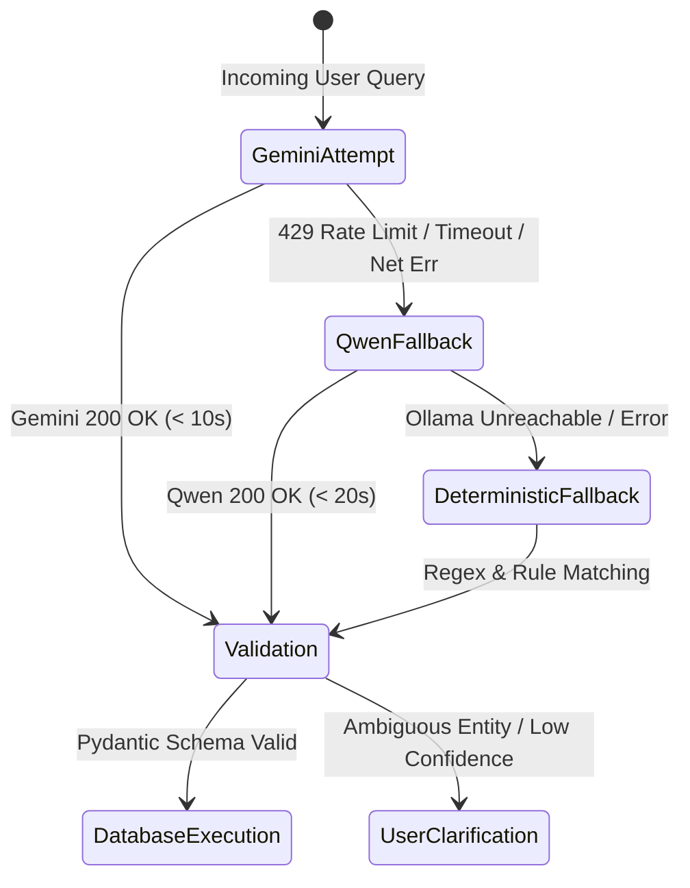

# CricInsight — Architectural Blueprint & System Design

## 1. Executive Summary & Core Principle

**CricInsight** is an NLP-powered conversational cricket performance analysis system. Users can query player and match statistics in natural language and receive deterministically calculated metrics, interactive visualizations (`fl_chart`), and evidence-grounded natural-language explanations.

### Cardinal Architectural Rule:
> **NLP understands the question. Retrieval finds the evidence. Python calculates the statistics deterministically. The language model explains the verified results.**
> 
> *The language model is NEVER permitted to invent cricket statistics or independently calculate authoritative numerical results.*

---

## 2. Technology Stack

| Layer | Technology | Role & Justification |
|---|---|---|
| **Frontend** | Flutter (Dart) | Modern, responsive cross-platform conversational interface |
| **Data Visualization** | `fl_chart` | Native Flutter chart rendering (line charts, bar charts, comparison plots) |
| **API & Business Logic** | Python 3.13 + FastAPI + Pydantic v2 | High-throughput asynchronous orchestration and strict contract validation |
| **Primary NLP** | Google Gemini (`google-genai` SDK) | Query interpretation, entity extraction, and grounded explanation |
| **Local Fallback NLP** | Qwen 2.5 via Ollama | Local on-device NLP fallback running on NVIDIA RTX 4050 GPU |
| **Primary Database** | PostgreSQL 16 + `pgvector` | Authoritative relational match & ball-by-ball store + vector search |
| **Local Columnar Mirror** | DuckDB | In-process analytical mirror for seamless zero-downtime test resilience |
| **Data Analytics Engine** | Python + Pandas + NumPy | 100% deterministic mathematical calculations for all metrics |
| **Source Dataset** | Official Cricsheet JSON | Single authoritative source of truth for match and delivery records |

---

## 3. Centralized Dual-Provider LLM Fallback Policy

### SLA & Bounded Timeouts:
- **`GEMINI_CONNECT_TIMEOUT`**: 3 seconds
- **`GEMINI_TOTAL_TIMEOUT`**: 10 seconds
- **`QWEN_TOTAL_TIMEOUT`**: 20 seconds
- **`LLM_MAX_TOTAL_DEADLINE`**: 32 seconds (hard request boundary)
- **Circuit Breaker**: Trips after 3 consecutive provider failures with a 60s cooldown, bypassing slow timeouts.

---

## 4. Grounded Hybrid RAG Architecture

Hybrid RAG retrieves cricket domain knowledge without contaminating authoritative numerical analytics:
1. **Full-Text Keyword Search**: PostgreSQL `tsvector` with `plainto_tsquery` and `ts_rank_cd`.
2. **Vector Similarity**: `pgvector` Euclidean/Cosine embedding distance.
3. **Reciprocal Rank Fusion (RRF)**:
   $$\text{RRF}(d) = \sum_{m \in \{\text{vector}, \text{fts}\}} \frac{1}{60 + \text{rank}_m(d)}$$
4. **Authority Separation**: Text from RAG is strictly supplementary (explaining scoring conventions, rules, and metric formulas). It is forbidden from overriding database counts or computed runs.
